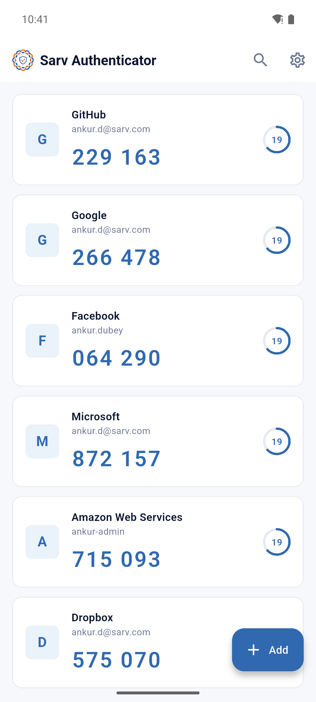
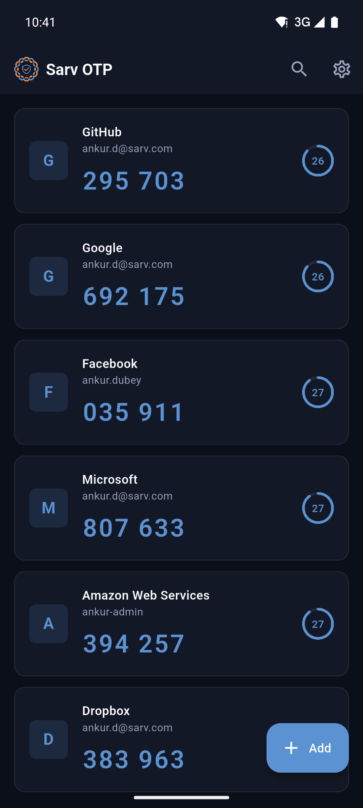
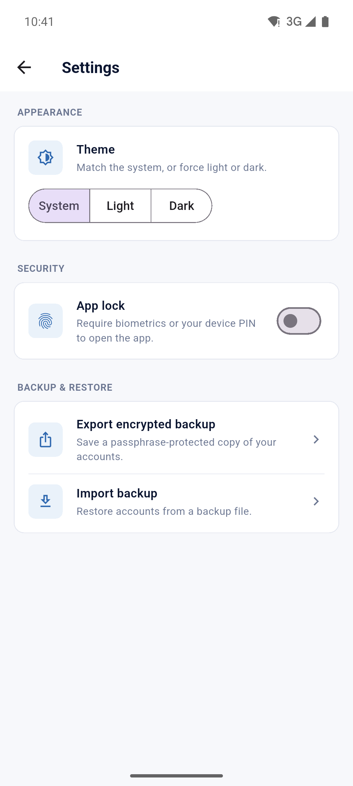
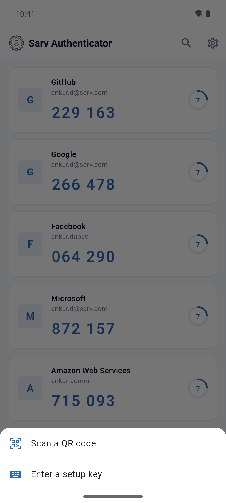
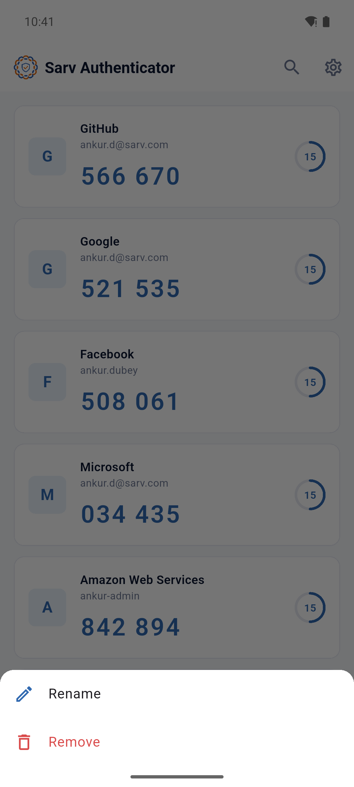
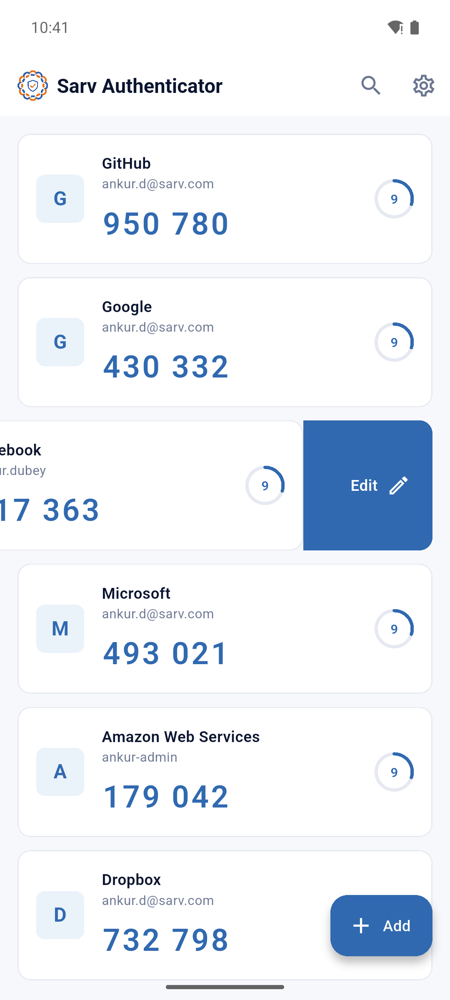
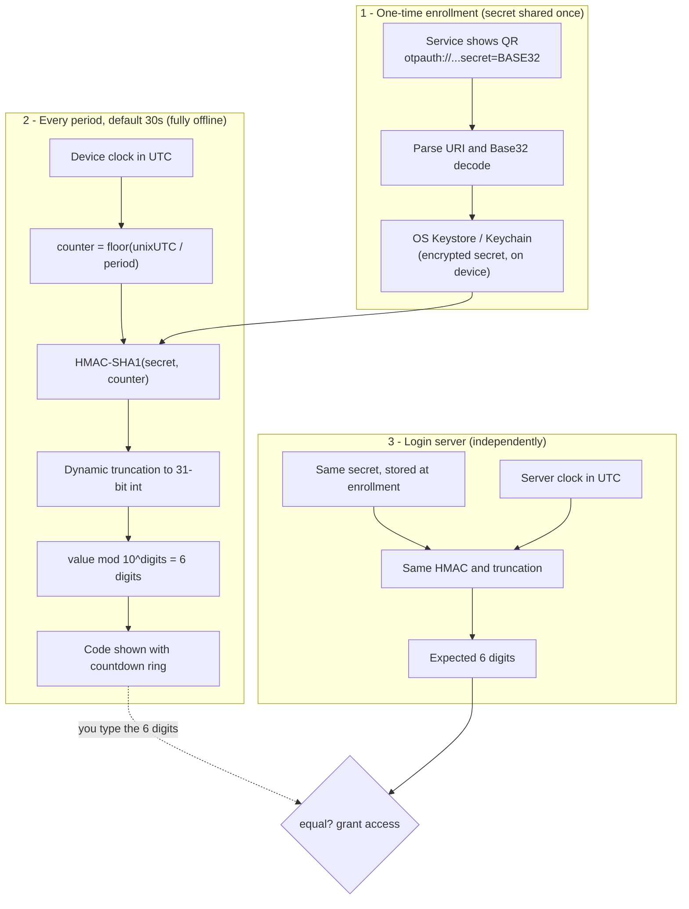

<p align="center">
  
</p>

<h1 align="center">Sarv OTP</h1>

<p align="center"><a href="https://sarv.github.io/OTP/"><strong>sarv.github.io/OTP</strong></a> — downloads, screenshots and features</p>

A clean-room, **Google Authenticator-compatible** TOTP/HOTP app built with Flutter
(Android + iOS from one codebase) and themed with the **Sarv design system**.

It is not a copy of Google's app — it implements the two open standards Google
Authenticator is built on, so it interoperates with every service that supports
"Authenticator app" 2FA (Google, GitHub, AWS, ...):

- **RFC 4226** — HOTP (HMAC-based one-time passwords)
- **RFC 6238** — TOTP (time-based, the 30-second rolling codes)
- **Key Uri Format** — the `otpauth://` URI a QR code encodes

## Screenshots

| Codes (light) | Codes (dark) | Settings | Add account |
|:---:|:---:|:---:|:---:|
|  |  |  |  |

Long-press a row for the actions menu; swipe to edit or delete:

| Actions menu (long-press) | Swipe to edit / delete |
|:---:|:---:|
|  |  |

> Codes shown are from demo accounts seeded for the screenshots — not live
> secrets. On device, screenshots and recordings of real codes come out blank.

## Install

Download links for every platform are on the [Sarv OTP website](https://sarv.github.io/OTP/).

- **Android** — grab the signed `.apk` from the
  [latest release](https://github.com/Sarv/OTP/releases) and sideload
  it (the one-time "allow unknown apps" prompt is a property of installing outside
  the Play Store, not a warning about the app). See [RELEASING.md](RELEASING.md).
- **iOS** — distributed through **TestFlight / the App Store**; iOS has no
  sideloadable equivalent of an APK. See [RELEASING-iOS.md](RELEASING-iOS.md) for
  the signing and submission setup.

Your privacy: the app collects nothing and makes no network requests — see the
[Privacy Policy](docs/PRIVACY.md).

## How it works — entirely offline, no network

A TOTP code is just an **HMAC of the current time under a shared secret**, truncated
to six digits. The secret is exchanged **once**, at enrollment (the QR code the
service shows you). After that the phone and the server never talk again — each side
independently computes the same six digits from the only two things they both have:
the **secret** and the **current UTC time**. That is the whole reason the app keeps
working in airplane mode, on a plane, or with the SIM removed.

**1. One-time enrollment** (the secret travels in the QR, so this needs no network of ours):

- The service shows an `otpauth://` QR embedding the Base32 `secret` plus parameters
  (issuer, algorithm, digit count, period). `core/otpauth_uri.dart` parses it;
  `core/base32.dart` decodes the secret.
- The raw secret is written straight into the **OS-backed keystore** — Android
  Keystore / iOS Keychain (`data/account_store.dart`). It never leaves the device,
  never touches plain storage, and never goes over any network.

**2. Every period** (default 30 s) — the fully offline loop, in `core/totp.dart`:

1. `counter = floor(unixTimeUTC / period)` — derived from the device clock in **UTC**,
   so the code is identical on every device regardless of time zone.
2. `digest = HMAC-SHA1(secret, counter)` (SHA-256 / SHA-512 also supported).
3. **Dynamic truncation** (RFC 4226 §5.3): the low nibble of the last byte picks a
   4-byte offset; read those 4 bytes and drop the top bit → a 31-bit integer.
4. `code = integer mod 10^digits`, zero-padded → the digits you see. A ring counts
   down the seconds left in the window.

**3. Verification:** the server stored the *same* secret at enrollment and runs the
*identical* math against its own UTC clock (usually accepting ±1 window for clock
drift), then compares. Nothing is transmitted at login — you simply type what both
sides already computed.



> **Offline by construction:** the only inputs are the on-device secret and the clock.
> There is no call home, no sync, and no account on any Sarv server — which is also why
> uninstalling without an [encrypted backup](#encrypted-export--import) is
> unrecoverable, by design.

## Layout

| Path | Responsibility |
|------|----------------|
| `lib/core/totp.dart` | HOTP/TOTP engine — pure functions, the cryptographic heart |
| `lib/core/base32.dart` | RFC 4648 Base32 decoder for secrets |
| `lib/core/otpauth_uri.dart` | Parses the `otpauth://` QR payload |
| `lib/data/account.dart` | Immutable account model + JSON |
| `lib/data/account_store.dart` | Encrypted persistence (Keystore/Keychain) — the only I/O edge |
| `lib/ui/theme.dart` | Sarv design tokens → Flutter theme (the only file with literal values) |
| `lib/ui/app_logo.dart` | Theme-aware brand mark (light/dark SVG variant) |
| `lib/ui/auth_gate.dart` · `lock_screen.dart` | Biometric app-lock gate + lock UI |
| `lib/ui/settings_screen.dart` · `passphrase_dialog.dart` | Settings — app-lock toggle + backup/restore |
| `lib/core/backup.dart` | Encrypted backup envelope (AES-GCM-256 + PBKDF2), pure & testable |
| `lib/data/backup_service.dart` | Backup file I/O — share-sheet export, file-picker import |
| `lib/data/app_lock.dart` | `local_auth` wrapper + persisted on/off preference |
| `lib/ui/manual_entry_screen.dart` | Manual enrollment: issuer/account/secret + SHA1/256/512, 6/8 digits, 30/60s |
| `lib/ui/*.dart` | Google Authenticator-style UI: code list, countdown ring, QR scanner |
| `test/totp_test.dart` | Verifies against the official RFC 4226 / 6238 test vectors |

## Biometric app-lock

When enabled, `AuthGate` prompts for biometrics on launch (and every time the app
returns from the background), falling back to the device PIN/pattern, so codes are
never shown on an unattended, unlocked device. It is **off by default** — turn it
on from the **Settings screen** (gear icon, top-right).

Turning the lock *on* requires a successful auth first, so you can't lock yourself
out with a credential that doesn't work; the change arms the gate on the next
background.

## Encrypted export / import

Settings → **Backup & restore** lets you move accounts between devices:

- **Export** encrypts the account list and opens the share sheet to save/send a
  `.sauthbackup` file. **Import** picks a backup file and merges it (duplicates,
  matched on issuer+account+secret, are skipped).
- Scheme: the accounts JSON is encrypted with **AES-GCM-256** under a key derived
  from your passphrase via **PBKDF2-HMAC-SHA256 (600k iterations)**, with a fresh
  random salt and nonce per export. The GCM auth tag means a wrong passphrase (or
  a tampered file) fails loudly instead of returning garbage.
- The passphrase is never stored and cannot be recovered — lose it and the backup
  is unreadable, by design.

All crypto uses the vetted `cryptography` package (`lib/core/backup.dart`); the
round-trip, wrong-passphrase and tamper behaviours are covered by
`test/backup_test.dart`.

## Branding & app icon

The brand mark lives in `assets/` in two theme variants, recoloured with the
design-system tokens:

| Asset | Colours | Use |
|-------|---------|-----|
| `authenticator-icon-light.svg` | brand `#2F5FAC` / accent `#E3701A` | light UI + light launcher |
| `authenticator-icon-dark.svg` | dark-token `#5B92D2` / `#FF8533` | dark UI + Android 13+ themed icon |
| `icon-{light,dark}-1024.png` | on `--surface` | iOS/store square icons |
| `adaptive-fg-{light,dark}-1024.png` | transparent, padded | Android adaptive foreground |

`AppLogo` picks the right SVG for the current theme automatically (lock screen,
app bar). Generate the platform launcher icons with:

```bash
flutter pub get
dart run flutter_launcher_icons   # config is in pubspec.yaml
```

## Theming

All colours, radii, spacing, fonts and type sizes come from
`../sarv_theme/design-system.css`, transcribed once into `lib/ui/theme.dart`
(`AppTokens.light` / `AppTokens.dark`). No component hard-codes a value.
Light and dark both follow the `.dark` block in the design system.

Fonts (Plus Jakarta Sans, JetBrains Mono) mirror `sarv_theme/fonts.css`; drop the
`.ttf` files into `assets/fonts/` and uncomment the `fonts:` block in
`pubspec.yaml` to bundle them offline.

## Run it

```bash
flutter create .      # one-time: generate the android/ ios/ platform folders
flutter pub get
flutter test          # verifies the engine against the RFC vectors
flutter run           # on a connected device/emulator
```

### One-time native setup (after `flutter create .`)

**Android** — biometrics needs a FragmentActivity, plus the permission:

- In `android/app/src/main/.../MainActivity.kt` change the base class to
  `FlutterFragmentActivity` (from `FlutterActivity`).
- In `android/app/src/main/AndroidManifest.xml` add inside `<manifest>`:
  ```xml
  <uses-permission android:name="android.permission.USE_BIOMETRIC"/>
  <uses-permission android:name="android.permission.CAMERA"/>
  ```

**iOS** — add to `ios/Runner/Info.plist`:
```xml
<key>NSFaceIDUsageDescription</key>
<string>Unlock Sarv OTP with Face ID to view your codes.</string>
<key>NSCameraUsageDescription</key>
<string>Scan QR codes to add authenticator accounts</string>
```

## Correctness

`test/totp_test.dart` asserts the engine reproduces every published vector from
RFC 6238 Appendix B (SHA1) and RFC 4226 Appendix D. These same vectors were
independently confirmed against a Python reference during development.

## Security notes

- Secrets live only in the OS-encrypted store, never in plain preferences, a
  file, logs, or the network.
- Biometric/PIN app-lock gates access and re-locks on backgrounding.
- Encrypted, passphrase-protected export/import (AES-GCM-256 + PBKDF2).
- **Screenshot/recording blocked** — live codes can't be captured on either
  platform.
  - Android: `MainActivity` sets `FLAG_SECURE`, so the system refuses
    screenshots and recordings ("Can't take screenshot") and blanks the recents
    preview — the same protection Google Authenticator uses.
  - iOS has no way to refuse a screenshot, so `SecureDisplay`
    (`ios/Runner/AppDelegate.swift`, enabled from `enableSecureDisplay()` in
    `main.dart`) draws the app inside a secure layer that iOS leaves out of
    screenshots, screen recordings and mirroring — the capture comes out
    black. The app then says "Screenshots are blocked to protect your codes",
    and a cover hides the codes in the app switcher.
- Consider adding: SHA256/512 selection in the enrollment UI (the engine already
  handles all three algorithms), and iCloud/Drive backup destinations.
